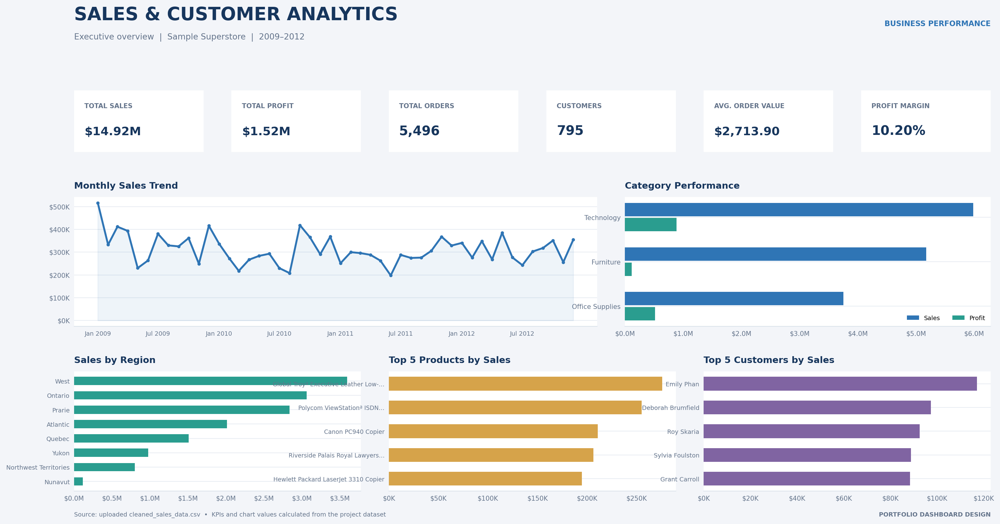

# Sales & Customer Analytics Dashboard

## Project Overview

This project analyzes retail sales and customer data to understand business performance, identify sales trends, and gain insights into customer purchasing behavior.

Using Python, Pandas, SQL, and data visualization, the project transforms raw sales data into meaningful business insights that support better decision-making.

## Business Problem

Retail businesses generate large amounts of sales data. However, understanding which products perform well, which customers contribute the most revenue, and which regions generate higher sales can be challenging.

This project explores retail sales data to identify important performance indicators, sales patterns, and customer trends.

## Project Objectives

- Analyze overall sales and profitability.
- Identify top-performing products and categories.
- Understand customer purchasing behavior.
- Evaluate regional sales performance.
- Analyze monthly and yearly sales trends.
- Present business insights through a dashboard visualization.

## Dashboard Preview



*Static dashboard visualization created using the project's cleaned dataset. It presents key metrics and analyses in a Power BI-inspired layout.*

## Key Performance Indicators

| KPI | Result |
|---|---:|
| Total Sales | $14,915,600.82 |
| Total Profit | $1,521,767.98 |
| Total Orders | 5,496 |
| Unique Customers | 795 |
| Average Order Value | $2,713.90 |
| Overall Profit Margin | 10.20% |

## Analysis Performed

### 1. Data Cleaning and Preprocessing

- Inspected dataset structure and data quality.
- Checked for missing values and duplicate records.
- Converted order and shipping dates into datetime format.
- Handled missing Product Base Margin values using median imputation.

### 2. Feature Engineering

Created additional business-related columns:

- Order Year
- Order Month
- Order Month Name
- Order Year-Month
- Shipping Days
- Profit Margin
- Order Value

### 3. Sales and Profit Analysis

- Analyzed sales and profit by product category.
- Compared regional sales performance.
- Evaluated customer segment performance.
- Identified monthly and yearly sales trends.

### 4. Product and Customer Ranking

- Ranked products based on sales and profit.
- Identified top-performing products.
- Identified customers contributing the highest sales.
- Examined products and customers with negative profit.

### 5. SQL Analysis

Loaded the cleaned dataset into an SQLite database and performed SQL queries for:

- Overall business KPIs.
- Product category performance.
- Regional sales performance.
- Top customer analysis.
- Monthly sales trends.

## Key Findings

- Technology generated the highest sales and profit among the three product categories.
- Furniture had a much lower profit margin than the other categories.
- Some high-sales products also recorded negative profit.
- Customer and product rankings helped identify major contributors to sales.
- Monthly and yearly analysis provided an overview of sales performance over time.

## Tools and Technologies

- Python
- Pandas
- NumPy
- Matplotlib
- Seaborn
- SQL
- SQLite
- Google Colab
- GitHub
- Power BI-inspired dashboard visualization

## Project Structure

```text
sales-customer-analytics-dashboard/
│
├── data/
│   ├── cleaned_sales_data.csv
│   └── README.md
│
├── notebooks/
│   ├── Sales_Customer_Analytics.ipynb
│   └── README.md
│
├── reports/
│   ├── sales_customer_analytics_dashboard.png
│   └── README.md
│
├── sql/
│   ├── sales_analysis.sql
│   └── README.md
│
├── README.md
└── requirements.txt
```

## Dataset

The project uses the Sample Superstore retail sales dataset.

The cleaned dataset contains **8,399 records and 28 columns**, including sales, profit, order dates, customer details, product categories, and regional information.

## Conclusion

This project demonstrates how Python and SQL can be used to clean, analyze, and transform retail sales data into useful business insights.

It helped develop practical skills in data preprocessing, feature engineering, KPI calculation, SQL analysis, data visualization, and business analytics.

---

**Project:** Sales & Customer Analytics Dashboard  
**Focus:** Data Analytics | Python | SQL | Business Intelligence
